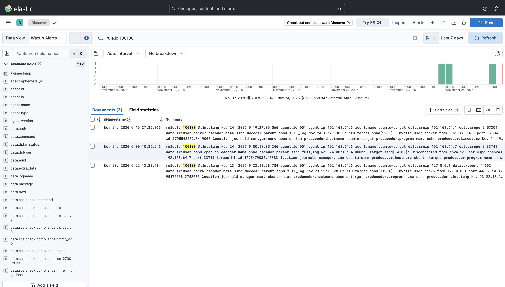

# Blue Team Security Lab

A hands-on, self-built home SIEM lab for practising **detection engineering, threat
hunting, and incident triage** — the day-to-day work of a SOC / blue-team analyst.

Everything runs locally on Apple silicon using UTM virtual machines. All detection is
real, reproducible, and evidence-backed (see `evidence/`).

## Start here

- **📖 [PROJECT.md](PROJECT.md)** — the full build write-up: architecture, tools, phases, and the live demo.
  exists, and how it maps to real enterprise security tools.
- **🧪 [PRACTICE.md](PRACTICE.md)** — step-by-step runbook to re-run the lab and practise
  the SOC workflow (detect a brute-force attack, run a vulnerability scan, verify AD
  hardening, confirm endpoint telemetry).
- **🚀 [HOW_TO_RUN.md](HOW_TO_RUN.md)** — quick-start to bring the environment up.
- **💡 [RATIONALE.md](RATIONALE.md)** — *why* each component exists and what real-world enterprise tool it maps to.

## Architecture

```
[ UBUNTU-SIEM ]  — Wazuh manager 4.14.10 + Elasticsearch 8.19.25 + Kibana 8.19.25
      |            (the "brain": collects, normalises, correlates, alerts)
      |  TCP 1514 / Filebeat -> Elasticsearch (wazuh-alerts-* index)
      |
[ UBUNTU-TARGET ] — Wazuh agent (the "endpoint": brute-forced, tampered, backdoored)
      ^ scanned
[ GREENBONE ]   — Greenbone CE / OpenVAS (vulnerability management; scans the target)
[ DC01 ]       — Samba AD DC (domain controller for LAB.LOCAL — identity + hardening)
[ WIN11 ]      — Windows 11 Pro ARM64 endpoint (domain-joined; Sysmon + Wazuh agent → SIEM)
```

- Hypervisor: UTM (native arm64, Shared NAT — never bridged).
- Ubuntu machines are Server 24.04 (arm64), SSH access via key, sudo NOPASSWD.
- WIN11 is Windows 11 Pro ARM64 under Parallels (UTM cannot boot the Windows 11 ARM64 installer).

## What's built (Phases 1–5)

**Phase 1 — SIEM core**: Elasticsearch (single node, security off for isolated lab),
Kibana, and the Wazuh manager, wired so agents' logs and security events flow into
Elasticsearch for searchable, correlated alerting.

**Phase 2 — endpoint detection + custom rules**: a second VM runs a Wazuh agent and
three custom detection rules were written and validated against simulated attacks:

| Rule ID | Name | Detects | MITRE ATT&CK |
|---------|------|---------|--------------|
| `100100` | Brute force | 6+ failed SSH logins in 120s (same source IP) | T1110 |
| `100200` | Integrity change | File modified under `/etc/` | T1565 |
| `100300` | Suspicious process | Netcat backdoor executed from `/tmp/.malware` | T1059 |

### Attack simulation
- **Brute force** — repeated `ssh` with non-existent users → rule 100100.
- **Tampering** — appended C2 hostnames to `/etc/hosts`, dropped a file in `/etc` → rule 100200.
- **Backdoor** — renamed `/bin/nc` to `/tmp/.malware/backdoor`, listening on 4444 → rule 100300 (via the command wodle).



*Kibana Discover — rule `100100` fired: three brute-force alerts; the top one is from the simulated attacker (source IP `192.168.64.1`, user `hacker`).*

**Phase 3 — vulnerability management**: a third VM runs Greenbone Community Edition
(OpenVAS) in Docker — `gvmd`, `openvasd`/`ospd-openvas`, `pg-gvm` (PostgreSQL), and the
GSA web UI. A "Full and fast" scan of UBUNTU-TARGET produced 23 results (SSH hardening
findings, TCP/ICMP timestamp disclosure, open port 4444). See `evidence/PHASE3_OPENVAS.md`.

**Phase 4 — Active Directory hardening**: a fourth VM runs a Samba AD
domain controller (domain `LAB.LOCAL`). Password/account policy hardened
(min length 14, max age 60, lockout threshold 5); Kerberos + DNS verified.
See `evidence/PHASE4_AD.md`.

**Phase 5 — Windows endpoint + Sysmon → SIEM**: a Windows 11 Pro ARM64 VM (Parallels)
was domain-joined to `LAB.LOCAL`, instrumented with **Sysmon** (SwiftOnSecurity config),
and enrolled as a **Wazuh agent** (`002/WIN11`, Active), streaming Windows + Sysmon
telemetry into the SIEM for detection. See `evidence/PHASE5_WINDOWS_SYSMON.md`.

## Repository layout

```
PROJECT.md                                # full build write-up: architecture, tools, rationale
PRACTICE.md                               # step-by-step runbook to re-run the lab and practise
HOW_TO_RUN.md                             # quick-start: bring the lab up + demonstrate each phase
RATIONALE.md                              # the 'why': component rationale + real-world mapping
rules/local_rules.xml                     # the 3 custom Wazuh detection rules
config/agent-wodle-command.xml            # suspicious-process monitoring (wodle command)
evidence/PHASE1_CHECKPOINT.md             # SIEM core bring-up (versions, health, URLs)
evidence/PHASE2_FINDINGS.md               # alert triage + verdicts + MITRE mapping
evidence/PHASE2_LIVE_BRUTEFORCE_DEMO.md   # live brute-force detection demo (rule 100100)
evidence/PHASE3_OPENVAS.md                # OpenVAS scan + severity breakdown + reproduction
evidence/PHASE4_AD.md                     # Samba AD DC: domain build + password/account hardening
evidence/PHASE5_WINDOWS_SYSMON.md         # Windows 11: domain join + Sysmon + Wazuh agent → SIEM
img/kibana-brute-force-alert.png          # screenshot of the brute-force alert in Kibana
```

## Reproduce

1. Deploy the rules: copy `rules/local_rules.xml` to the manager's `/var/ossec/etc/rules/`
   and restart `wazuh-manager`.
2. Add `config/agent-wodle-command.xml` to the agent's `ossec.conf` and restart `wazuh-agent`.
3. Fire the simulations above and confirm alerts in Kibana (index `wazuh-alerts-*`).
4. For vulnerability scanning, follow `evidence/PHASE3_OPENVAS.md` (Greenbone CE in Docker).

> No credentials, private keys, or personal data are stored in this repository.
